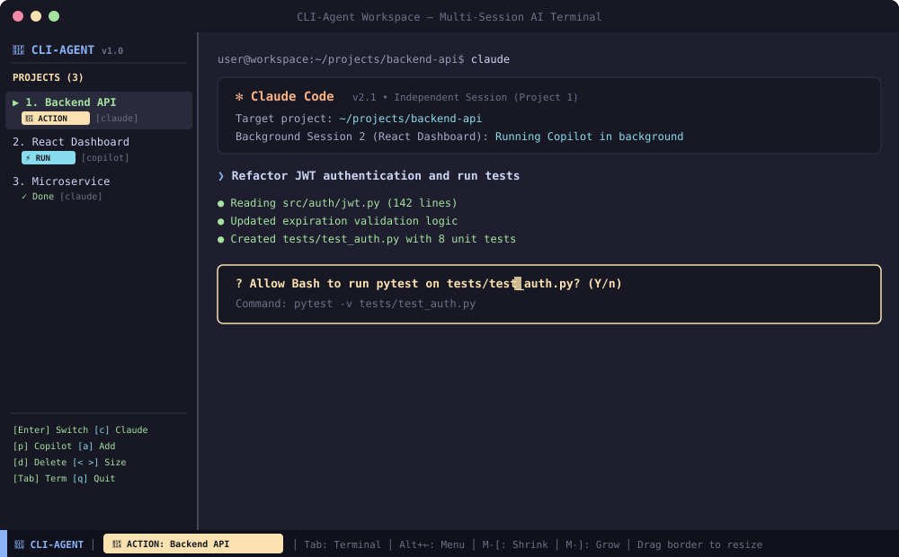

# 🤖 CLI-Agent

[](LICENSE)
[](#requirements)
[](#requirements)
[](#architecture)

> **AI Agent Terminal Workspace Manager**  
> A split-pane terminal environment with project bookmarks on the left and an interactive shell on the right to launch your AI agents (**Claude Code**, **GitHub Copilot CLI**, etc.) without manually changing directories.

---

<p align="center">
  
</p>

---

## ⚡ Overview

When working with CLI-based AI coding agents like **Claude Code** or **GitHub Copilot CLI**, developers often find themselves constantly switching between terminal windows, running `cd /path/to/project`, and remembering custom run commands.

**CLI-Agent** solves this by turning your terminal into an integrated workspace:
- **Truly Independent Sessions**: Each project bookmark runs in its **own isolated terminal session**. Claude Code in Project 1 continues working in the background while you switch to Project 2. No command collisions or `cd` interruptions.
- **Compact & Resizable Sidebar**: Default slim 26-column width. Easily resize on the fly with `<` / `>` keys, `w` width presets, or by dragging the divider with your mouse.
- **Right Pane (Terminal)**: Dedicated, full-fidelity interactive terminal for the active project.
- **Instant Agent Launcher**: Press `c` to launch Claude Code, `p` for Copilot CLI, or `Enter` for your default shell in that project.
- **Real-Time Notification Badges**: Automatically monitors all sessions (active & background) and alerts you when an agent needs input (`? Allow tool`, `(y/n)`), is running, finished, or hit an error.
- **Git Awareness**: Displays live Git branches and uncommitted changes for each project at a glance.
- **Zero External Dependencies**: Built with native Node.js and standard `tmux`. Boots up in under 50ms.

---

## 🚀 Quick Install (One-Liner)

Install CLI-Agent in seconds via your terminal:

```bash
curl -fsSL https://raw.githubusercontent.com/juliendevelopment/cli-agent/main/install.sh | bash
```

### Alternative Installation Methods

<details>
<summary><b>Via GitHub CLI (<code>gh</code>)</b></summary>

```bash
gh api repos/juliendevelopment/cli-agent/contents/install.sh -q .content | base64 -d | bash
```
</details>

<details>
<summary><b>Via Git Clone</b></summary>

```bash
git clone https://github.com/juliendevelopment/cli-agent.git ~/.cli-agent && ~/.cli-agent/install.sh
```
</details>

### Requirements
- **Node.js** (v18.0.0 or higher)
- **tmux** (automatically installed by the script if missing on Fedora, Ubuntu, Debian, Arch, or macOS)

---

## 💻 Usage

### Launch the Workspace

Simply run:
```bash
cli-agent
```

---

### Keyboard Shortcuts (Sidebar Menu)

| Shortcut | Action |
|---|---|
| `↑` / `↓` or `k` / `j` | Navigate project bookmarks |
| `Enter` | Switch view to selected project's independent terminal |
| `c` | Switch to project & launch **Claude Code** (`claude`) |
| `p` | Switch to project & launch **GitHub Copilot CLI** (`copilot`) |
| `Space` / `o` | Open interactive agent selector modal |
| `a` | Add a new bookmark (interactive dialog) |
| `e` | Edit selected bookmark (Name / Path) |
| `d` | Delete selected bookmark & terminate its session |
| `r` | Reset / clear status badge |
| `<` / `>` or `[` / `]` | **Resize sidebar width** (shrink / expand by 2 cols) |
| `w` | **Cycle width presets** (24, 30, 38 cols) |
| `Tab` or `Alt + →` | Switch focus directly to the terminal pane |
| `Alt + ←` or `F1` | Switch focus back to the sidebar menu |
| `Alt + [` / `Alt + ]` | Resize sidebar from terminal pane |
| `q` | Quit CLI-Agent cleanly |

> 💡 **Mouse Support**: Mouse clicking is fully supported. You can click on any bookmark to switch sessions or drag the vertical divider border with your mouse to resize the sidebar.

---

## 🚦 Live Statuses & Notifications

CLI-Agent monitors active processes and terminal outputs in real time, displaying colored indicators next to your bookmarks:

| Badge | Color | Description / Trigger |
|---|---|---|
| `🔔 ACTION REQUIRED` | 🟡 **Bright Yellow** (highlight) | Triggered when an agent asks a question or requires confirmation (`? Allow tool`, `(y/n)`, `[y/N]`, `Waiting for input`). An alert also appears in the bottom status bar! |
| `⚡ RUNNING...` | 🔵 **Bright Cyan** | Active execution or background generation (`Thinking...`, `running command`, active node/python process). |
| `✓ Done` | 🟢 **Green** | The agent has completed its task successfully (`Task complete`, `Done in...`, prompt returned). |
| `✗ ERROR` | 🔴 **Bright Red** | Command error detected (`fatal:`, `Command failed`, `npm ERR!`, uncaught exception). |
| `⏳ RATE LIMIT` | 🟣 **Magenta** | API rate limit or quota warning detected (`Rate limit reached`, `Please wait`). |
| `● Idle` | ⚪ **Gray** | Shell prompt idle and ready for commands. |
| ` main* (3)` | 🟡 **Yellow tag** | Git branch name and number of uncommitted modified files in the repository. |

### Scriptable Notifications

You can also send status notifications programmatically from your own scripts, CI hooks, or background jobs:

```bash
# Set status for a bookmark by name or index
cli-agent notify "Backend API" input "Needs permission approval"
cli-agent notify "Backend API" done  "All unit tests passed"
cli-agent notify "Backend API" error "Build failed"
cli-agent notify "Backend API" clear
```

---

## 🛠️ Command-Line Management

Manage your bookmarks directly without entering the interactive UI:

```bash
# Add current directory as a bookmark
cli-agent add "My Project" .

# Add a directory with a custom path
cli-agent add "Web Dashboard" ~/dev/projects/dashboard

# List all saved bookmarks
cli-agent list

# Remove a bookmark by index or name
cli-agent remove 2

# Terminate active CLI-Agent workspace session
cli-agent kill

# Display help and usage
cli-agent help
```

---

## 🔄 Updating CLI-Agent

Keep your installation up to date with a single command:

```bash
cli-agent update
```

This downloads and extracts the latest release from GitHub into `~/.cli-agent/`.  
**Your saved bookmarks in `~/.config/cli-agent/bookmarks.json` are completely preserved and untouched.**

---

## ⚙️ Configuration File

Bookmarks and settings are stored in standard JSON at:
`~/.config/cli-agent/bookmarks.json`

Example:
```json
{
  "version": 1,
  "selectedIndex": 0,
  "bookmarks": [
    {
      "id": "bm_1",
      "name": "Backend API",
      "path": "/home/user/projects/backend-api",
      "agent": "claude",
      "createdAt": "2026-11-12T19:00:00.000Z"
    },
    {
      "id": "bm_2",
      "name": "Web Dashboard",
      "path": "/home/user/projects/dashboard",
      "agent": "copilot",
      "createdAt": "2026-11-12T19:05:00.000Z"
    }
  ]
}
```

---

## 📄 License

MIT © [Julien](https://github.com/juliendevelopment)
